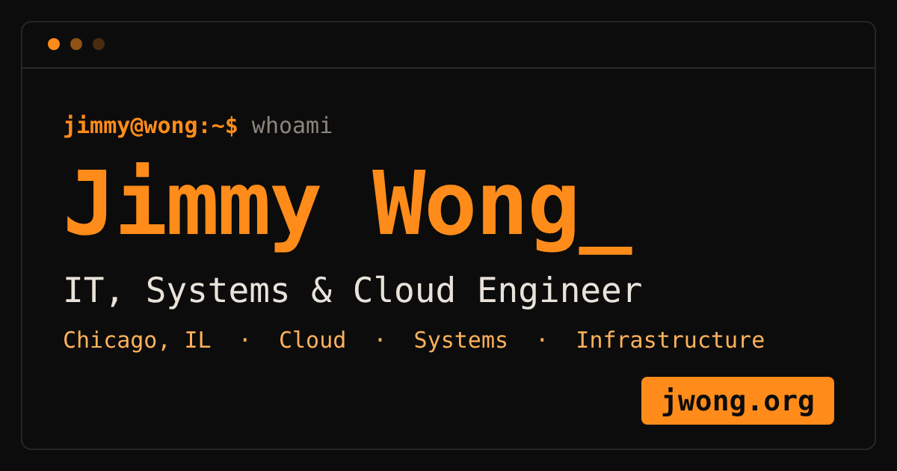

<div align="center">

# Jimmy Wong · jwong.org

**Personal portfolio site: a terminal-style, orange-on-black page for recruiters and anyone curious.**

[**jwong.org**](https://jwong.org) · [Resume](https://resume.jwong.org) · [LinkedIn](https://www.linkedin.com/in/wongjimmy545)



</div>

## About

This is the source for my portfolio at [jwong.org](https://jwong.org). It shows who I am, my experience, education, skills,
projects (as short write-ups), and an events timeline, with a quick way to contact me. I am an IT, systems and cloud
engineer based in Chicago, looking for a full-time role starting January 2028.

My resume is built separately from `resume.yaml` in the [`jwong545/resume`](https://github.com/jwong545/resume) repo
and served at [resume.jwong.org](https://resume.jwong.org). This site links to it.

## Features

- **Terminal look, orange theme:** monospace type, `jimmy@wong:~$` prompt, blinking cursor.
- **Mobile first:** built for phones first, then widened for tablets and desktops. Large tap targets, no sideways scrolling.
- **Project write-ups:** each project card opens its own blog-style page on the site.
- **Events timeline:** conferences and workshops, with a "show more" expander.
- **Back-to-top button** that appears after scrolling.
- **Visitor clock:** shows your local date, time and time zone next to UTC. It runs entirely in your browser; nothing is sent anywhere.
- **Business card:** print-ready front and back (3.5 x 2 in) with a QR code to this site, plus a saveable contact file (`.vcf`).
- **Accessible:** skip link, keyboard-friendly navigation and expanders, and reduced-motion support.

## Tech and security

Plain **HTML, CSS and a small amount of vanilla JavaScript**. No framework, no build step, no cookies, no trackers, no
third-party requests (fonts are the visitor's own system monospace).

Hosted on **Cloudflare** with HTTPS. Security headers are set in [`site/_headers`](site/_headers):

- strict `Content-Security-Policy` (only this site's own files; no inline scripts or external resources)
- `Strict-Transport-Security` (HTTPS only)
- `X-Content-Type-Options`, `X-Frame-Options`, `Referrer-Policy`, `Permissions-Policy`, and cross-origin isolation headers
- external links use `rel="noopener noreferrer"`

## Repository layout

```
site/                 # everything that gets published
  index.html          # home: about, skills, experience, education, projects, events, contact
  projects/           # one page per project write-up
  card.html           # business card page (QR code, print PDF, contact file)
  404.html            # custom "not found" page
  style.css  card.css  main.js
  _headers            # security headers
  robots.txt  sitemap.xml  favicon.svg  og-image.png
```

## Deploy

Pushing to `main` deploys the site on Cloudflare, publishing the `site/` folder. Other branches get a preview URL.
There is no build command.

## Editing tips

- Content lives in `site/index.html` and `site/projects/*.html`; styling in `site/style.css`.
- If you add analytics, embeds or external fonts, update the `Content-Security-Policy` in `site/_headers`, or the browser will block them.
- Keep `site/sitemap.xml` and the canonical URLs in sync if pages are added.

## License

**Code:** the HTML, CSS and JavaScript are released under the [MIT License](LICENSE). You are free to reuse and adapt them,
as long as you keep the copyright notice.

**Content is not covered by the MIT License.** All rights reserved. This means my personal content: the text (bio,
experience, project write-ups), resume, name, photos, logo and business card design. Please do not copy it or present it as your own.
If you build your own site from this code, replace all of it with yours.

Questions? Reach out via [jwong.org](https://jwong.org/#contact).
